<section class="cover">

Stadt Hildesheim | Zentrale Vergabestelle

Öffentlicher Vergabeassistent

Benutzerhandbuch

Version {{VERSION}} · Stand {{DATE}}

<strong>Hinweis:</strong> Dies ist ein Prototyp aus dem Hackathon „Hi-Zukunft 2026“. Alle Anträge, Lieferanten, Budgets und E-Mail-Adressen sind Demodaten. Die E-Mail-Adressen enden auf <code>.example</code>, damit während einer Vorführung keine echte Firma angeschrieben wird.

</section>

<section class="overview">

# So funktioniert der Assistent

Der Assistent unterstützt die Zentrale Vergabestelle bei zwei Routineaufgaben: der **Prüfung von Beschaffungsanträgen** und der **Wertung von Angeboten**. Der Agent (KI) bereitet vor und prüft. **Entscheidungen trifft immer ein Mensch.**

</section>

<h1 class="page">1 Zweck</h1>

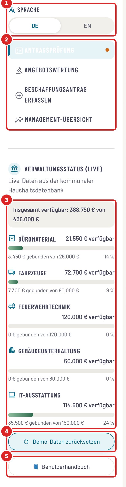{.tall}

Der Öffentliche Vergabeassistent erledigt die zeitaufwendige Vorarbeit:

- Er **liest Anträge und Angebote aus**, auch als PDF.
- Er **prüft Regeln**: Ist genug Budget da? Ist der Lieferant zugelassen? Gibt es im Fachbereich Beschäftigte mit besonderen Bedürfnissen (Barrierefreiheit)?
- Er **schlägt vor**: eine Empfehlung zum Antrag, eine Budgetverschiebung, Punkte für die Angebotswertung.
- Er **erstellt Dokumente**: Anmeldebogen, Entwurf eines Deckungsantrags, Zuschlags- und Absageschreiben.

Was der Agent nicht tut: Er genehmigt nichts, er vergibt keinen Auftrag und er verschickt keine E-Mail. Diese Schritte löst immer eine Person aus. Eine Übersicht steht in Kapitel 10.

# 2 Schnellstart

**App starten.** Im Projektordner einmalig `pip install -r requirements.txt` ausführen, in der Datei `.env` den Schlüssel `GEMINI_API_KEY` eintragen und dann `streamlit run app.py` starten. Die App öffnet sich im Browser.

1. **Sprache wählen (1):** DE oder EN. Alle Beschriftungen und die Schreiben folgen dieser Sprache.
2. **Bereich wählen (2):** Antragsprüfung, Angebotswertung, Beschaffungsantrag erfassen, Management-Übersicht.
3. **Budget im Blick (3):** Die Balken zeigen je Haushaltsposition, wie viel noch verfügbar ist (Kapitel 9).
4. **Demo-Daten zurücksetzen (4):** Stellt den Ausgangszustand wieder her: drei offene Anträge, die Original-Budgets und der Beispielverlauf.
5. **Benutzerhandbuch (5):** Lädt dieses Handbuch in der eingestellten Sprache herunter.

# 3 Antragsprüfung

## 3.1 Offene Anträge

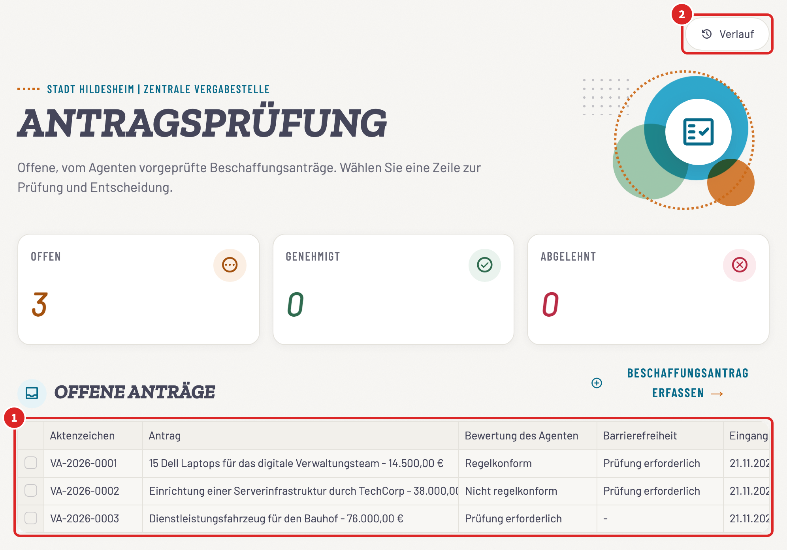

Die Tabelle (1) zeigt alle Anträge, die noch entschieden werden müssen, mit der Bewertung des Agenten: **Regelkonform**, **Prüfung erforderlich** oder **Nicht regelkonform**, und mit dem Ergebnis der Barrierefreiheitsprüfung. Ein Klick auf eine Zeile öffnet den Antrag. Über **Verlauf** (2) sehen Sie alle bisherigen Entscheidungen (Kapitel 7).

## 3.2 Antrag öffnen und die Prüfungen lesen

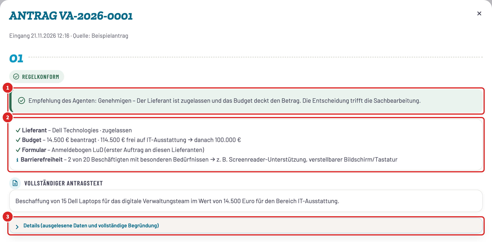

- **Empfehlung des Agenten (1):** oben in einem farbigen Kasten mit einem Satz Begründung: Genehmigen (grün), Prüfung erforderlich (orange) oder Ablehnen (rot). Die Statusmarke darüber wiederholt die Einschätzung, z. B. REGELKONFORM. Liegt der Betrag höchstens 5 % über dem verfügbaren Budget, lautet die Empfehlung „Prüfung erforderlich“.
- **Prüfungen (2):** eine Zeile je Prüfung: ✓ bestanden, ⚠ Aufmerksamkeit nötig, ✗ nicht bestanden, ℹ nur zur Information.
  - **Lieferant:** zugelassen oder nicht.
  - **Budget:** beantragt, frei und danach verfügbar.
  - **Formular:** Neuvergabe oder Auftragserweiterung.
  - **Barrierefreiheit:** Beschäftigte mit besonderen Bedürfnissen und ein passender Hinweis. Der Hinweis steht auch im Anmeldebogen unter „Sonstige Hinweise“.
- **Details (3):** ausgelesene Daten (Lieferant, Betrag, Haushaltsposition mit Konto, Formular, Beschäftigte) und die vollständige Begründung des Agenten Schritt für Schritt.
- Zwischen den Prüfungen und den Details steht der vollständige Antragstext.

## 3.3 Entscheiden: Genehmigen oder Ablehnen

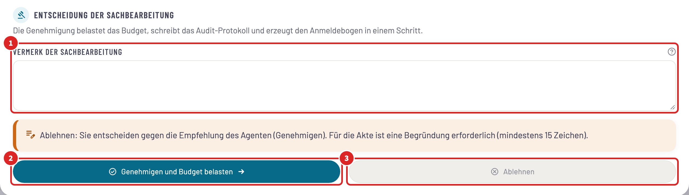

Es gibt immer beide Schaltflächen. Die Schaltfläche, die der Empfehlung entspricht, ist blau gefüllt.

1. Optional einen **Vermerk** (1) schreiben.
2. **Genehmigen und Budget belasten** (2): Der Betrag wird von der Haushaltsposition abgezogen, die Entscheidung wird protokolliert und der **Anmeldebogen** (PDF) wird automatisch heruntergeladen.
3. **Ablehnen** (3): Es wird nichts gebucht. Die Entscheidung erscheint im Verlauf.

## 3.4 Gegen die Empfehlung entscheiden (Abweichung)

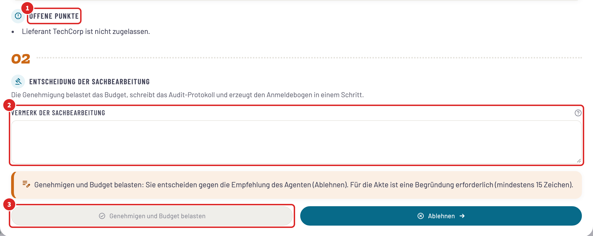

Unter **Offene Punkte** (1) nennt der Agent, warum er ablehnt, zum Beispiel „Lieferant TechCorp ist nicht zugelassen.“. Wer gegen die Empfehlung entscheidet, sieht einen orangefarbenen Hinweis. Die Schaltfläche (3) bleibt gesperrt, bis im **Vermerk** (2) eine Begründung mit **mindestens 15 Zeichen** steht. Die Abweichung wird im Verlauf markiert und in der Aufsicht über den Agenten gezählt. Bei „Prüfung erforderlich“ ist der Vermerk freiwillig.

## 3.5 Budgetverschiebung und Deckungsantrag

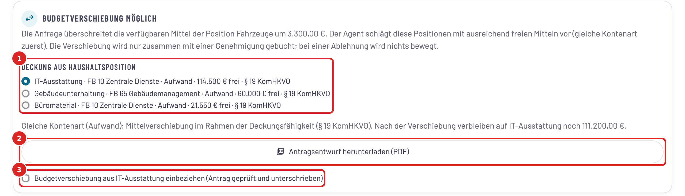

Reicht das Budget nicht und ist das der **einzige** offene Punkt, schlägt der Agent Haushaltspositionen mit freien Mitteln vor (gleiche Kontenart zuerst).

1. Haushaltsposition wählen (1). Die Rechtsgrundlage steht darunter: § 19 KomHKVO bei gleicher Kontenart, sonst § 117 NKomVG.
2. **Antragsentwurf herunterladen (PDF)** (2): ein vorausgefüllter **Deckungsantrag**. Prüfen, unterschreiben lassen, ablegen.
3. **Budgetverschiebung einbeziehen** (3) anhaken und dann genehmigen. Verschiebung und Genehmigung werden zusammen gebucht. Bei einer Ablehnung wird nichts bewegt.

# 4 Beschaffungsantrag erfassen

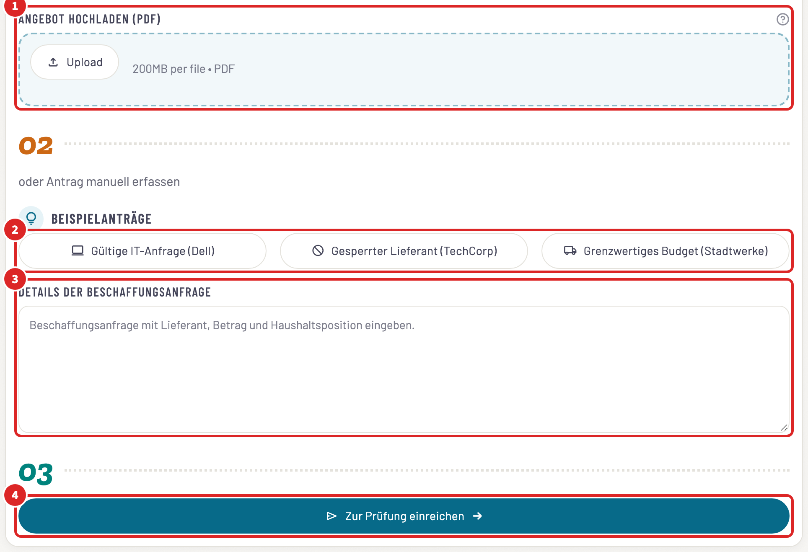

1. Einen Antrag als **PDF hochladen** (1) oder den Text in das Feld (3) schreiben. Die **Beispielanträge** (2) füllen das Feld mit Demotexten.
2. Der Text sollte Lieferant, Betrag, Haushaltsposition und Gegenstand nennen.
3. **Zur Prüfung einreichen** (4): Der Agent liest Lieferant, Betrag und Haushaltsposition aus (Gemini) und führt dieselben Prüfungen aus wie in Kapitel 3: Lieferant, Budget, frühere Aufträge (Neuvergabe oder Auftragserweiterung) und Barrierefreiheit. Der Antrag erscheint danach in der Antragsprüfung.

# 5 Angebotswertung

## 5.1 Antrag, Kriterien und Angebote

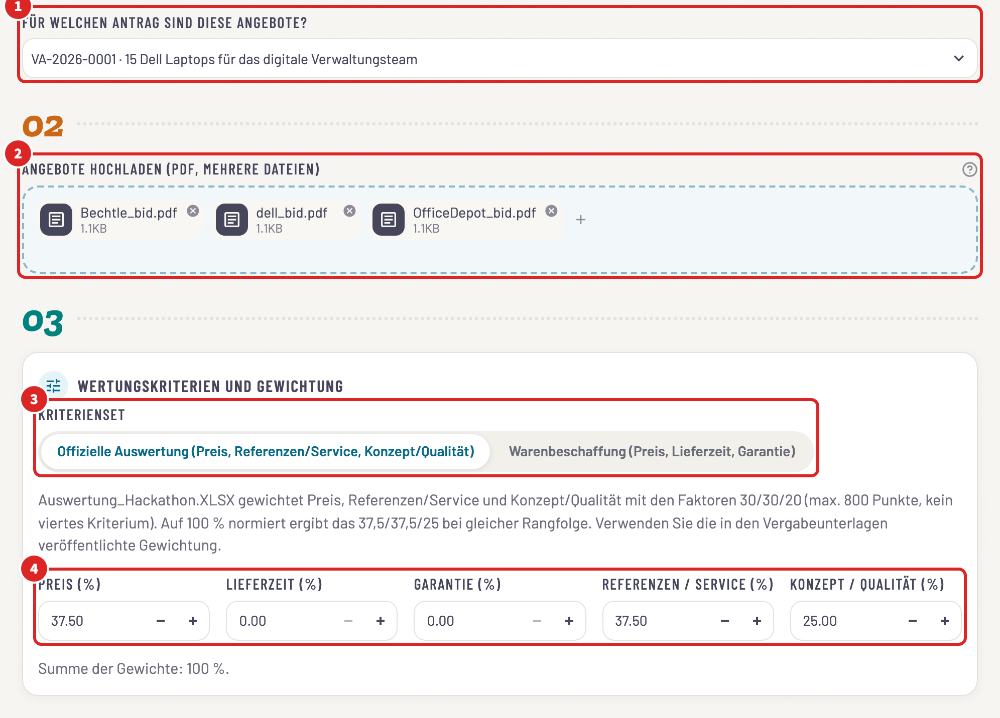

1. **Antrag wählen** (1): Angeboten werden nur genehmigte Anträge, die noch nicht gewertet wurden. Für Ausschreibungen ohne Antrag gibt es „Sonstige Ausschreibung (ohne Antrag)“.
2. **Angebote hochladen** (2): Je Bieter eine PDF. Der Agent liest Bieter, Preis, Gegenstand, Menge, Lieferzeit, Garantie, Referenzen, Service, Bindefrist und E-Mail-Adresse aus.
3. **Kriterienset** (3): „Offizielle Auswertung“ (Preis, Referenzen/Service, Konzept/Qualität) oder „Warenbeschaffung“ (Preis, Lieferzeit, Garantie).
4. **Gewichtung** (4): Die Gewichte müssen zusammen **100 %** ergeben. Die offizielle Auswertung (Auswertung_Hackathon.XLSX) gewichtet 30/30/20, normiert also 37,5/37,5/25 %.

## 5.2 Angebotsdaten und Punktevorschlag

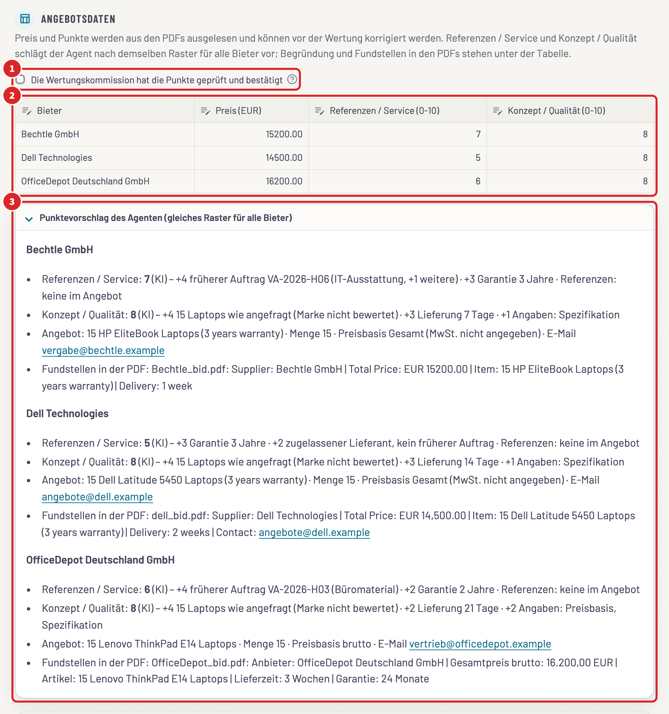

Die Tabelle (2) zeigt **Bieter, Preis (EUR), Referenzen / Service (0-10) und Konzept / Qualität (0-10)**. Der Agent füllt alles vor. Jeder Wert kann vor der Wertung geändert werden. Unter **Punktevorschlag des Agenten** (3) stehen für jeden Bieter die Begründung und die Fundstellen in der PDF.

**Referenzen / Service:** Kann man sich auf diesen Lieferanten bei Lieferung und Betreuung verlassen?

| Merkmal | Punkte |
|---|---|
| Früherer genehmigter Auftrag der Stadt (beliebige Haushaltsposition) | +4 |
| Zugelassener Lieferant, aber kein früherer Auftrag | +2 |
| Im Angebot genannte Referenzen: 2 oder mehr / 1 | +3 / +2 |
| Garantie 3 Jahre oder Vor-Ort-Service / 2 Jahre / 1 Jahr | +3 / +2 / +1 |

**Konzept / Qualität:** Wie gut passt das Angebot zur Anfrage?

| Merkmal | Punkte |
|---|---|
| Art und Menge wie angefragt / nur teilweise (die Marke zählt nicht) | +4 / +2 |
| Lieferzeit bis 2 Wochen / bis 4 Wochen / länger | +3 / +2 / +1 |
| Angaben vollständig: Preisbasis, Spezifikation, Bindefrist (je Angabe) | bis +3 |

Höchstens 10 Punkte je Kriterium. Für alle Bieter gilt dasselbe Raster. Findet der Agent für ein Kriterium **gar keine Grundlage**, bleibt die Zelle leer und zeigt „erforderlich“. Nur dann muss die Kommission einen Wert eintragen.

## 5.3 Bestätigen und Wertung starten

1. Die Kommission prüft die Werte und ändert sie bei Bedarf.
2. **„Die Wertungskommission hat die Punkte geprüft und bestätigt“** (1) anhaken.
3. **Wertung starten**. Die Schaltfläche ist gesperrt, solange die Bestätigung fehlt, eine Zelle „erforderlich“ ist oder die Gewichte nicht 100 % ergeben.

## 5.4 Ergebnis lesen

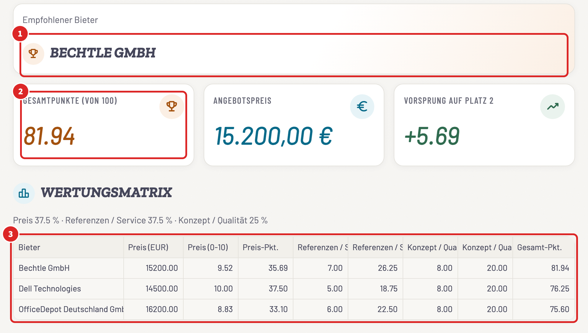

- **Empfohlener Bieter** (1) mit **Gesamtpunkten von 100** (2), Angebotspreis und Vorsprung auf Platz 2.
- Die **Wertungsmatrix** (3) zeigt je Kriterium die Bewertung (0-10) und die gewichteten Punkte (Bewertung × Gewicht / 10).
- **Preisformel** aus Auswertung_Hackathon.XLSX: Das günstigste Angebot erhält 10 Punkte; ein gedachtes Angebot zum doppelten Preis erhält 0 Punkte. Punkte = 10 / niedrigster Preis × (2 × niedrigster Preis − Preis), nie unter 0. Beispiel: niedrigster Preis 50.000 € → 10 Punkte; 70.000 € → 6 Punkte; 100.000 € → 0 Punkte.

# 6 Zuschlags- und Absageschreiben

{.small}

Mit der Wertung erzeugt der Agent die Schreiben einmal, auf Deutsch und Englisch, und speichert sie. Versendet wird genau dieser gespeicherte Text.

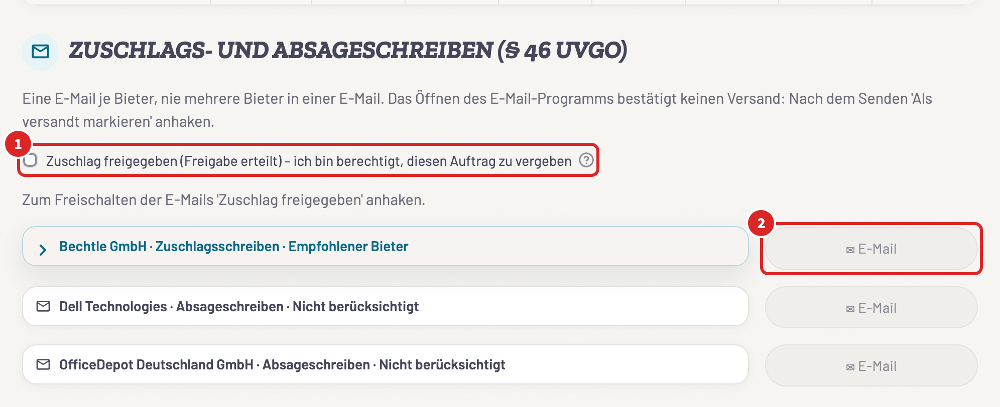

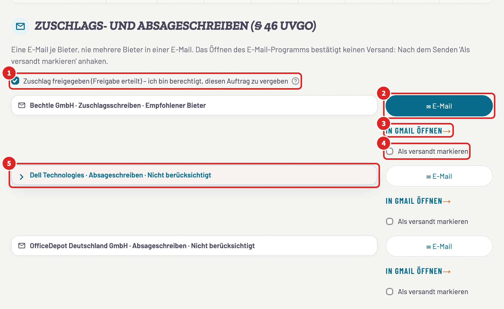

1. **„Zuschlag freigegeben (Freigabe erteilt)“** (1) anhaken, aber nur mit der Berechtigung zur Vergabe. Damit werden **alle** E-Mail-Buttons frei: das Zuschlagsschreiben und alle Absageschreiben.
2. **✉ E-Mail** (2) öffnet Ihr E-Mail-Programm mit Empfänger, Betreff und Text. **In Gmail öffnen** (3) öffnet dasselbe in Gmail. Senden Sie die E-Mail selbst, je Bieter eine eigene E-Mail und nie mehrere Bieter in Kopie.
3. **Als versandt markieren** (4) anhaken, sobald die E-Mail gesendet ist. Das ändert nur den Status („Zuschlag versandt“ / „Absage versandt“) und sperrt nichts.
4. Mit einem Klick auf die Zeile (5) lesen Sie das Schreiben. Fehlt eine E-Mail-Adresse, erscheint in der Zeile ein Eingabefeld.

**Zuschlagsschreiben:** Aktenzeichen, Gegenstand, Menge, Zuschlagspreis, die nächsten Schritte (die Bestellung bzw. der Vertrag folgt) und eine Ansprechperson.

**Absageschreiben (§ 46 UVgO)** enthalten den Namen des erfolgreichen Bieters, den eigenen Rang, die eigene Bewertung in Worten und die Kriterien, bei denen das Siegerangebot besser war. Sie enthalten **nie** den Preis des Siegers, die Preise anderer Bieter oder die Punkte anderer Bieter.

# 7 Verlauf

**Antragsverlauf** (Antragsprüfung → Verlauf):

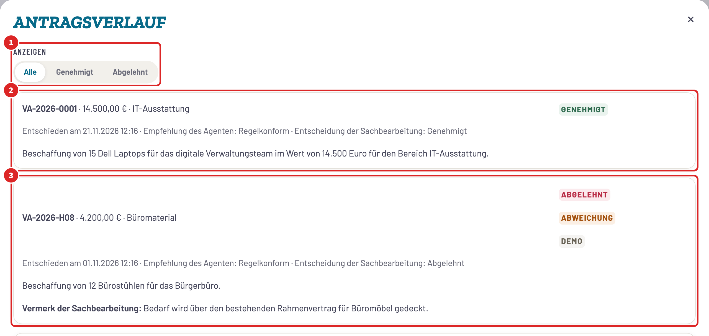

Mit dem Filter (1) zeigen Sie alle, die genehmigten oder die abgelehnten Anträge. Jeder Eintrag (2) zeigt die Empfehlung des Agenten neben der Entscheidung der Sachbearbeitung. Abweichungen (3) sind orange markiert, mit dem Vermerk.

**Verlauf der Angebotswertungen** (Angebotswertung → Verlauf):

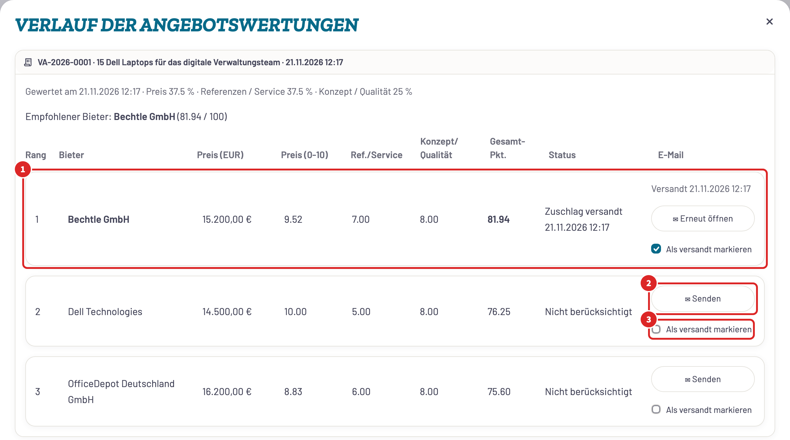

Je Wertung sehen Sie Rang, Bieter, Preis, die endgültigen Punkte je Kriterium und den Status (1). In der Spalte E-Mail können Sie Schreiben auch Tage später senden (2) und als versandt markieren (3). Wurde der Zuschlag noch nicht freigegeben, steht die Freigabe-Checkbox über der Tabelle.

# 8 Management-Übersicht

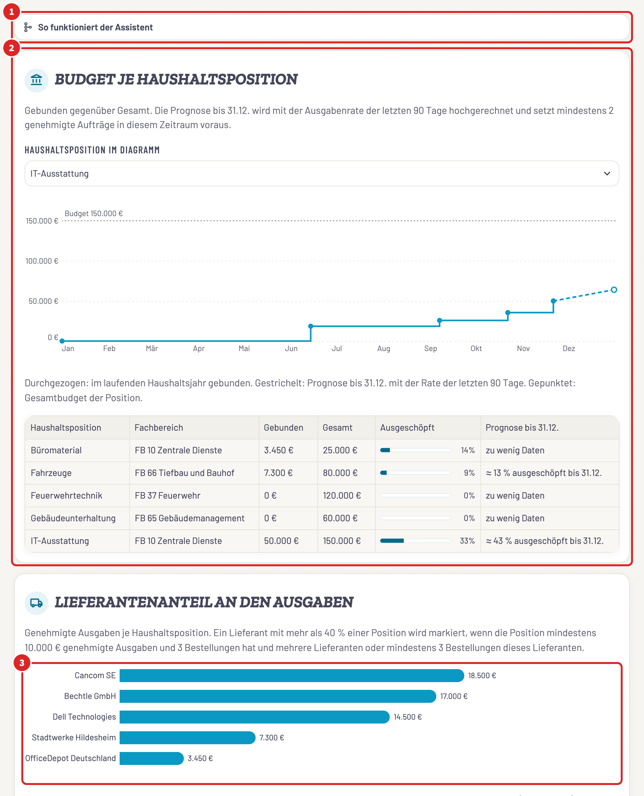

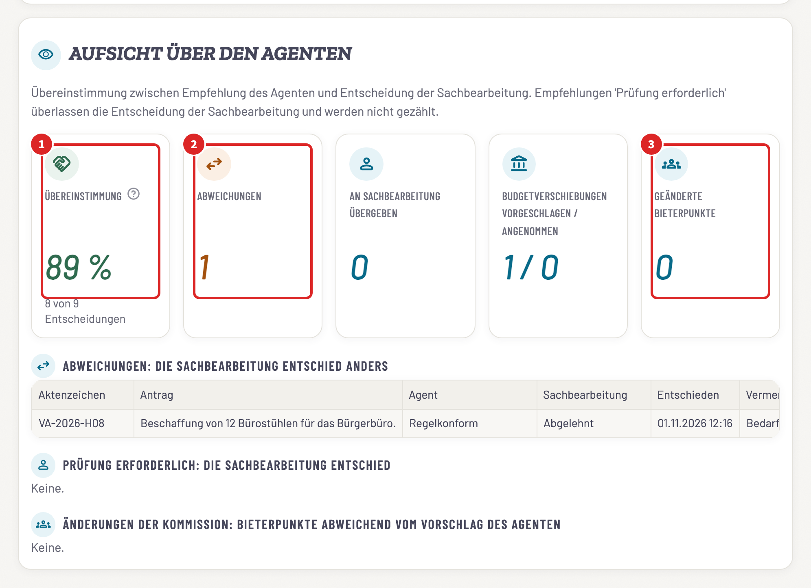

- **So funktioniert der Assistent** (1) zeigt das Ablaufdiagramm von Seite 2.
- **Budget je Haushaltsposition** (2): Das Diagramm zeigt für die gewählte Position die im Haushaltsjahr gebundenen Mittel (durchgezogen), die Prognose bis 31.12. mit der Ausgabenrate der letzten 90 Tage (gestrichelt) und das Gesamtbudget (gepunktet). Die Tabelle nennt „Ausgeschöpft ~Datum“, wenn das Budget noch in diesem Jahr aufgebraucht wird (orange, wenn innerhalb von 60 Tagen), sonst „≈ NN % ausgeschöpft bis 31.12.“. Für eine Prognose sind mindestens 2 genehmigte Bestellungen in 90 Tagen nötig.
- **Lieferantenanteil** (3): Balken je Lieferant über alle Positionen. Orange markiert wird ein Lieferant mit mehr als 40 % einer Position, wenn die Position mindestens 10.000 € genehmigte Ausgaben und 3 Bestellungen hat, und es mehrere Lieferanten oder mindestens 3 Bestellungen dieses Lieferanten gibt. Kleinere Positionen erhalten nur den Hinweis „zu wenig Daten für eine Konzentrationsprüfung“.

**Aufsicht über den Agenten:** die **Übereinstimmung** (1) zwischen Empfehlung und Entscheidung (nur Empfehlungen „Genehmigen“ und „Ablehnen“), die **Abweichungen** (2) mit Vermerk, die an die Sachbearbeitung übergebenen Fälle, die Budgetverschiebungen (vorgeschlagen / angenommen) und die von der Kommission **geänderten Bieterpunkte** (3).

# 9 Budgetanzeige in der Seitenleiste

Für jede Haushaltsposition zeigt ein Balken, wie viel bereits gebunden ist. Rechts steht der noch **verfügbare** Betrag, darunter „gebunden von Gesamt“ und der Anteil in Prozent. Oben steht die Summe über alle Positionen. Nach jeder Genehmigung und jeder Budgetverschiebung werden die Werte sofort aktualisiert (Seitenleiste in Kapitel 2, Markierung 3).

# 10 Wo der Mensch entscheidet

{.small}

| Schritt | Agent (KI) | Mensch | Wo |
|---|---|---|---|
| Antrag genehmigen / ablehnen | prüft und empfiehlt | Sachbearbeitung entscheidet | Antragsprüfung |
| Abweichung von der Empfehlung | zeigt den Hinweis | Begründung im Vermerk (mind. 15 Zeichen) | Antragsprüfung |
| Budgetverschiebung | schlägt Position vor, füllt Deckungsantrag vor | unterschreibt, hakt an, genehmigt | Antragsprüfung |
| Punkte der Angebote | schlägt Punkte nach Raster vor | Kommission prüft, ändert, bestätigt | Angebotswertung |
| Zuschlag | empfiehlt den Bieter, erstellt die Schreiben | Freigabe durch eine berechtigte Person | Schreiben / Verlauf |
| E-Mails versenden | füllt Empfänger, Betreff und Text vor | sendet selbst, markiert als versandt | Schreiben / Verlauf |

# 11 Häufige Fragen

**Warum ist eine Schaltfläche grau?**

- *Genehmigen oder Ablehnen:* Sie entscheiden gegen die Empfehlung, und der Vermerk hat weniger als 15 Zeichen.
- *Wertung starten:* Die Bestätigung der Kommission fehlt, eine Zelle zeigt „erforderlich“, oder die Gewichte ergeben nicht 100 %. Der orangefarbene Kasten nennt den Grund.
- *✉ E-Mail:* Der Zuschlag ist noch nicht freigegeben (Hinweis unter der Checkbox), oder die E-Mail-Adresse fehlt.

**E-Mail-Adresse fehlt.** Die Adresse wird aus der Angebots-PDF gelesen, sonst aus der Lieferantentabelle. Fehlt sie in beiden, erscheint „E-Mail-Adresse fehlt“ mit einem Eingabefeld in der Zeile des Bieters.

**Die PDF wurde nicht richtig gelesen.** Gescannte PDFs ohne Text können nicht gelesen werden. Prüfen Sie die Fundstellen unter „Punktevorschlag des Agenten“ und korrigieren Sie Bieter oder Preis direkt in der Tabelle. Stammt der Bietername aus dem Dateinamen, erscheint ein Hinweis.

**Die Wertung ist gesperrt.** Der orangefarbene Kasten listet je Bieter, was fehlt, zum Beispiel „Referenzen / Service – keine Zusammenarbeit bekannt und keine Referenzen im Angebot“. Tragen Sie nur diese Werte ein.

**Kein Antrag in der Auswahl der Angebotswertung.** Es werden nur genehmigte Anträge ohne Wertung angeboten. Genehmigen Sie zuerst einen Antrag oder wählen Sie „Sonstige Ausschreibung (ohne Antrag)“.

**Beim Einreichen eines Antrags erscheint ein Fehler.** Zum Auslesen neuer Anträge braucht die App einen gültigen `GEMINI_API_KEY` in der Datei `.env`.

# 12 Glossar

| Deutsch | English | Bedeutung |
|---|---|---|
| Vergabe | Procurement / award procedure | Verfahren, in dem ein öffentlicher Auftrag erteilt wird |
| Vergabestelle | Procurement office | Stelle, die Vergaben durchführt |
| Zuschlag | Award (of contract) | Annahme eines Angebots; damit kommt der Vertrag zustande |
| Absageschreiben | Rejection letter | Information an nicht berücksichtigte Bieter (§ 46 UVgO) |
| UVgO | Sub-threshold procurement regulation | Unterschwellenvergabeordnung: Regeln für Vergaben unterhalb der EU-Schwellenwerte |
| Anmeldebogen | Registration form | Formular für eine Neuvergabe (LuD) oder eine Auftragserweiterung |
| Deckungsantrag | Budget cover application | Antrag, Mittel aus einer anderen Haushaltsposition zu verwenden |
| Haushaltsposition | Budget line | Teil des Haushalts mit eigenem Konto und Budget |
| Wertungskriterien | Evaluation criteria | Kriterien mit Gewichtung, nach denen Angebote bewertet werden |
| Referenzen / Service | References / Service | Verlässlichkeit bei Lieferung und Betreuung |
| Konzept / Qualität | Concept / Quality | Wie gut das Angebot zur Anfrage passt |
| Wertungskommission | Evaluation committee | Gremium, das die Punkte prüft und bestätigt |
| Empfohlener Bieter | Recommended supplier | Bieter mit den meisten Punkten |
| Abweichung | Override | Entscheidung gegen die Empfehlung des Agenten |
| Bindefrist | Offer validity | Zeitraum, in dem der Bieter an sein Angebot gebunden ist |
