<section class="cover">

Stadt Hildesheim | Zentrale Vergabestelle

Public Procurement Assistant

User manual

Version {{VERSION}} · {{DATE}}

<strong>Note:</strong> This is a prototype from the “Hi-Zukunft 2026” hackathon. All requests, suppliers, budgets and email addresses are demo data. The email addresses end in <code>.example</code>, so no real company is contacted during a demonstration.

</section>

<section class="overview">

# How the system works

The assistant supports the City of Hildesheim's central procurement office with two routine tasks: **checking procurement requests** and **evaluating bids**. The agent (AI) prepares and checks. **A human always decides.**

</section>

<h1 class="page">1 Purpose</h1>

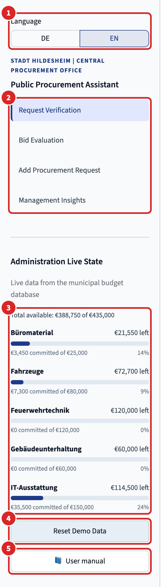{.tall}

The Public Procurement Assistant takes over the time-consuming preparation:

- It **reads requests and bids**, including PDFs.
- It **checks the rules**: Is there enough budget? Is the supplier approved? Does the department have staff with special needs (accessibility)?
- It **proposes**: a recommendation for each request, a budget transfer, scores for the bid evaluation.
- It **drafts documents**: the Anmeldebogen (registration form), a draft Deckungsantrag (budget cover application), award and rejection letters.

What the agent does not do: it approves nothing, awards no contract and sends no email. A person always takes these steps. Chapter 10 has an overview.

# 2 Quick start

**Start the app.** In the project folder, run `pip install -r requirements.txt` once, set `GEMINI_API_KEY` in the `.env` file, then run `streamlit run app.py`. The app opens in the browser.

1. **Choose the language (1):** DE or EN. All labels and the letters follow this setting.
2. **Choose an area (2):** Request Verification, Bid Evaluation, Add Procurement Request, Management Insights.
3. **Keep an eye on the budget (3):** the bars show how much is still available per budget line (chapter 9).
4. **Reset Demo Data (4):** restores the starting state: three pending requests, the original budgets and the example history.
5. **User manual (5):** downloads this manual in the current language.

# 3 Request Verification

## 3.1 Pending requests

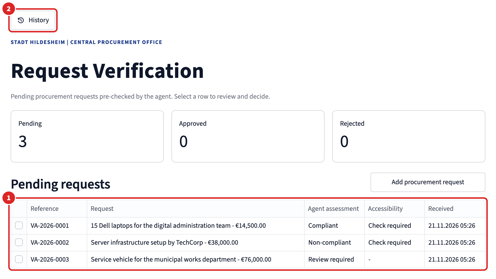

The table (1) lists all requests that still need a decision, with the agent's assessment (**Compliant**, **Review required** or **Non-compliant**) and the accessibility check. Click a row to open the request. **History** (2) shows all previous decisions (chapter 7).

## 3.2 Open a request and read the checks

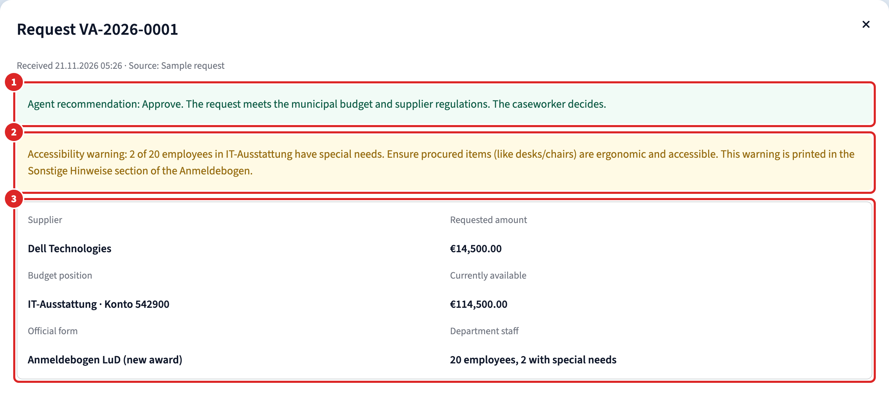

- **Agent recommendation (1):** Approve, Reject or Review required, with the reason. The agent checks whether the supplier is approved and whether the budget line has enough funds. If the amount is at most 5 % above the available budget, the recommendation is "Review required".
- **Accessibility (2):** if the department has staff with special needs, a warning appears. It is also printed in the Anmeldebogen under "Sonstige Hinweise".
- **Key facts (3):** supplier, amount, budget line and account, available budget, the matching form (new award or contract extension) and the number of staff.
- Below these are the full request text and the agent's step-by-step check log.

## 3.3 Decide: approve or reject

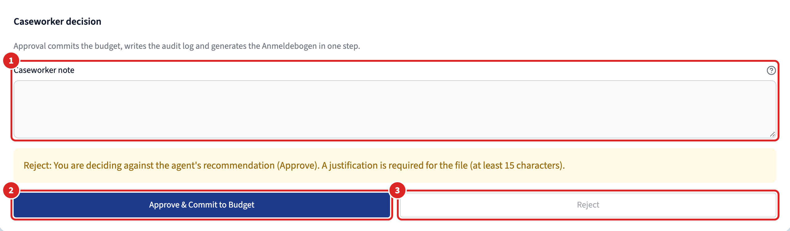

Both buttons are always there. The one that matches the recommendation is highlighted in navy.

1. Optionally write a **caseworker note** (1).
2. **Approve & Commit to Budget** (2): the amount is deducted from the budget line, the decision is logged and the **Anmeldebogen** (PDF) downloads automatically.
3. **Reject** (3): nothing is booked. The decision appears in the history.

## 3.4 Deciding against the recommendation (override)

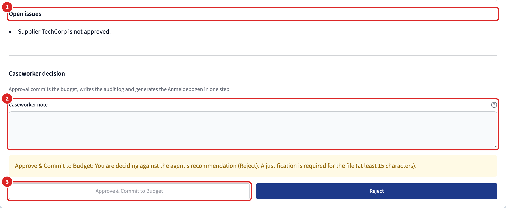

Under **Open issues** (1) the agent explains why it recommends rejection, for example "Supplier TechCorp is not approved". If you decide against the recommendation, a yellow notice appears. The button (3) stays disabled until the **caseworker note** (2) contains a justification of **at least 15 characters**. The override is flagged in the history and counted in AI oversight. For "Review required" the note is optional.

## 3.5 Budget transfer and Deckungsantrag

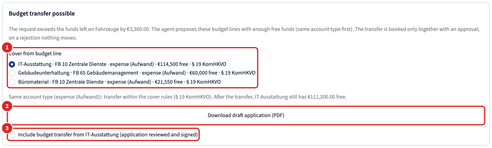

If the budget is insufficient and that is the **only** open issue, the agent suggests budget lines with free funds (same account type first).

1. Choose a budget line (1). The legal basis is shown below it: § 19 KomHKVO for the same account type, otherwise § 117 NKomVG.
2. **Download draft application (PDF)** (2): a pre-filled **Deckungsantrag**. Check it, have it signed, file it.
3. Tick **Include budget transfer** (3), then approve. The transfer and the approval are booked together. On rejection nothing moves.

# 4 Add Procurement Request

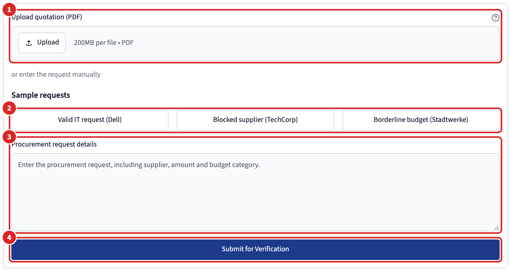

1. **Upload a request as PDF** (1) or type the text in the box (3). The **sample requests** (2) fill the box with demo texts.
2. The text should name the supplier, amount, budget line and item.
3. **Submit for Verification** (4): the agent reads supplier, amount and budget line (Gemini) and runs the same checks as in chapter 3: supplier, budget, previous contracts (new award or contract extension) and accessibility. The request then appears in Request Verification.

# 5 Bid Evaluation

## 5.1 Request, criteria and bids

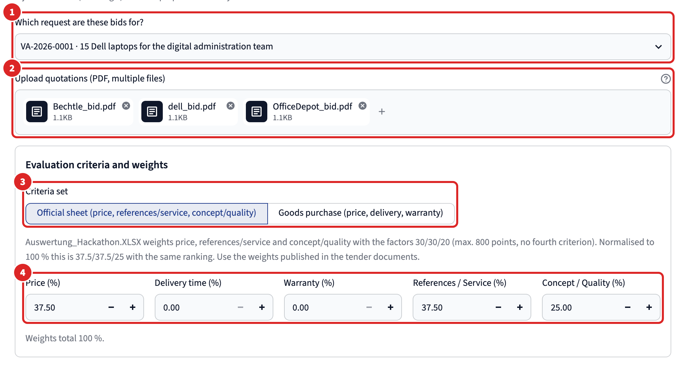

1. **Choose the request** (1): only approved requests that have not been evaluated yet are offered. "Other tender (no request)" covers tenders without a request.
2. **Upload the bids** (2): one PDF per bidder. The agent reads bidder, price, item, quantity, delivery time, warranty, references, service, offer validity and email address.
3. **Criteria set** (3): "Official sheet" (price, references/service, concept/quality) or "Goods purchase" (price, delivery, warranty).
4. **Weights** (4): the weights must total **100 %**. The official sheet (Auswertung_Hackathon.XLSX) weights 30/30/20, normalised 37.5/37.5/25 %.

## 5.2 Bid data and proposed scores

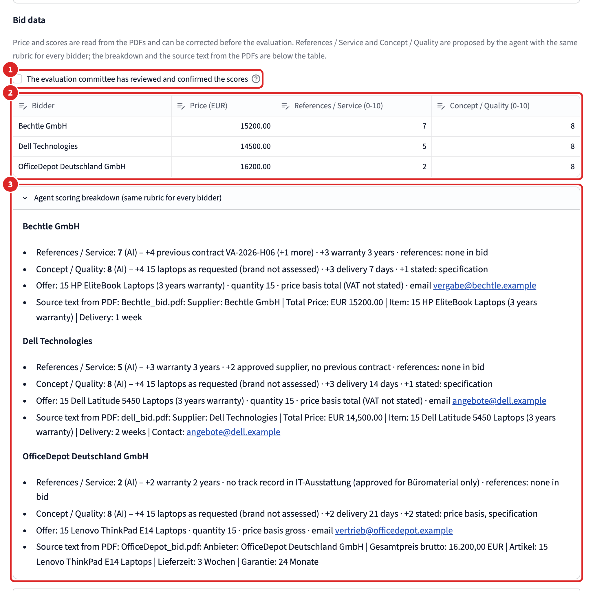

The table (2) shows **Bidder, Price (EUR), References / Service (0-10) and Concept / Quality (0-10)**. The agent fills in everything, and any value can be edited before the evaluation. The **Agent scoring breakdown** (3) lists the reasons and the source text from the PDF for every bidder.

**References / Service:** can this supplier be trusted to deliver and support us?

| Evidence | Points |
|---|---|
| Previous contract with the city on the same budget line | +4 |
| Approved supplier, but no previous contract | +2 |
| References named in the bid: 2 or more / 1 | +3 / +2 |
| Warranty 3 years or on-site service / 2 years / 1 year | +3 / +2 / +1 |

**Concept / Quality:** how well does this offer fit the request?

| Evidence | Points |
|---|---|
| Item type and quantity as requested / partly (the brand does not count) | +4 / +2 |
| Delivery up to 2 weeks / up to 4 weeks / longer | +3 / +2 / +1 |
| Complete offer: price basis, specification, offer validity (per item stated) | up to +3 |

Each criterion has a maximum of 10 points, and the same rubric applies to every bidder. If the agent finds **no evidence at all** for a criterion, the cell stays empty and shows "required". Only then does the committee have to enter a value.

## 5.3 Confirm and run

1. The committee reviews the values and edits them where needed.
2. Tick **"The evaluation committee has reviewed and confirmed the scores"** (1).
3. **Run Evaluation**. The button stays disabled while the confirmation is missing, a cell shows "required", or the weights do not total 100 %.

## 5.4 Read the result

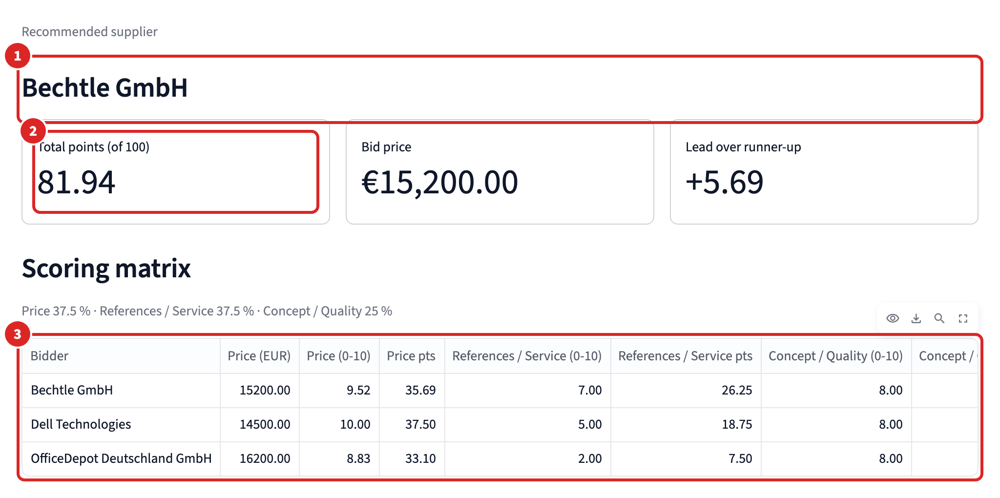

- **Recommended supplier** (1) with its **total points out of 100** (2), bid price and lead over the runner-up.
- The **scoring matrix** (3) shows the score (0-10) and the weighted points (score × weight / 10) for each criterion.
- **Price formula** from Auswertung_Hackathon.XLSX: the lowest bid gets 10 points; a notional bid at twice that price gets 0 points. Points = 10 / lowest price × (2 × lowest price − price), never below 0. Example: lowest price EUR 50,000 → 10 points; EUR 70,000 → 6 points; EUR 100,000 → 0 points.

# 6 Award and rejection letters

{.small}

When the evaluation runs, the agent writes the letters once, in German and English, and stores them. Exactly this stored text is what gets sent.

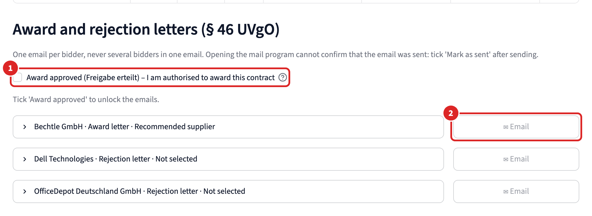

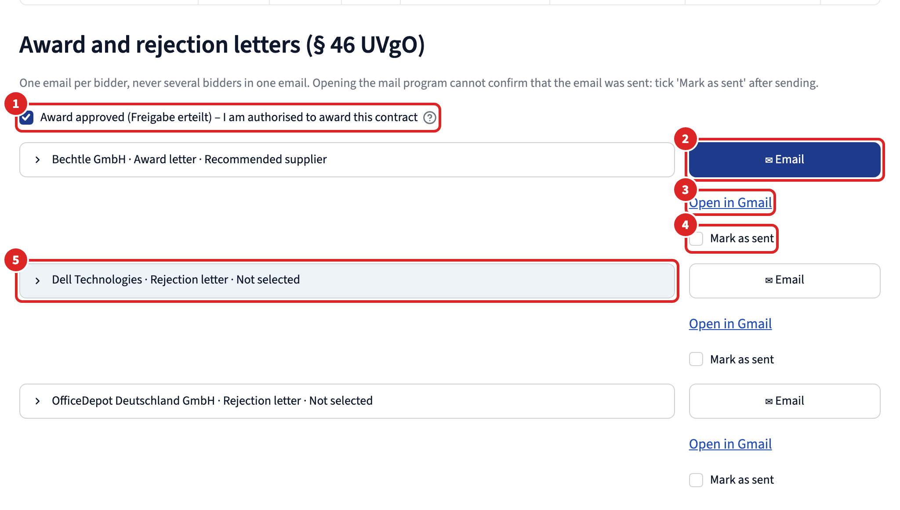

1. Tick **"Award approved (Freigabe erteilt)"** (1), but only if you are authorised to award the contract. This unlocks **all** email buttons: the award letter and every rejection letter.
2. **✉ Email** (2) opens your default mail program with recipient, subject and text filled in. **Open in Gmail** (3) does the same in Gmail. You send the email yourself: one email per bidder, never several bidders in copy.
3. Tick **Mark as sent** (4) once the email has been sent. This only changes the status ("Award sent" / "Rejection sent") and locks nothing.
4. Click the row (5) to read the letter. If an email address is missing, an input field appears in that row.

**Award letter:** reference, item, quantity, awarded price, the next steps (the order or contract follows) and a contact person.

**Rejection letters (§ 46 UVgO)** contain the name of the successful bidder, the bidder's own rank, its own assessment in words and the criteria on which the winning offer was better. They **never** contain the winner's price, other bidders' prices or other bidders' scores.

# 7 History

**Request history** (Request Verification → History):

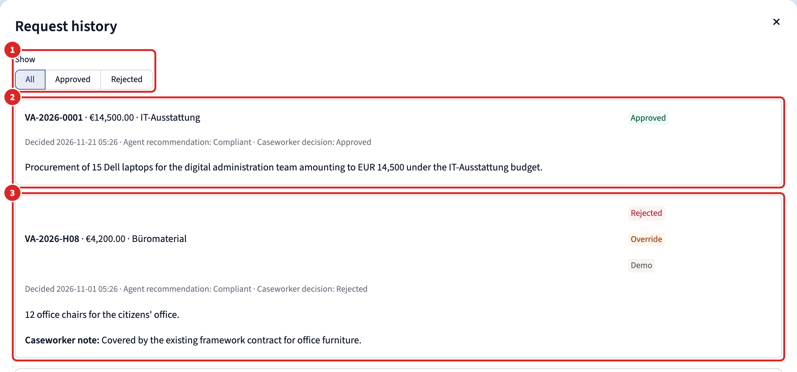

The filter (1) shows all, approved or rejected requests. Each entry (2) shows the agent's recommendation next to the caseworker's decision. Overrides (3) carry an orange badge and the note.

**Bid evaluation history** (Bid Evaluation → History):

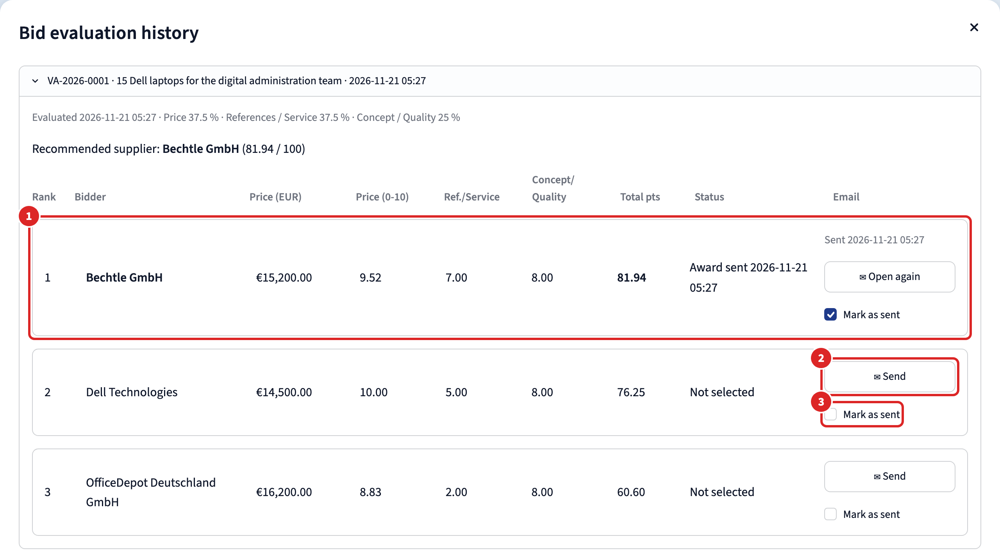

Each evaluation lists rank, bidder, price, the final score per criterion and the status (1). In the Email column, letters can also be sent days later (2) and marked as sent (3). If the award has not been approved yet, the approval checkbox appears above the table.

# 8 Management Insights

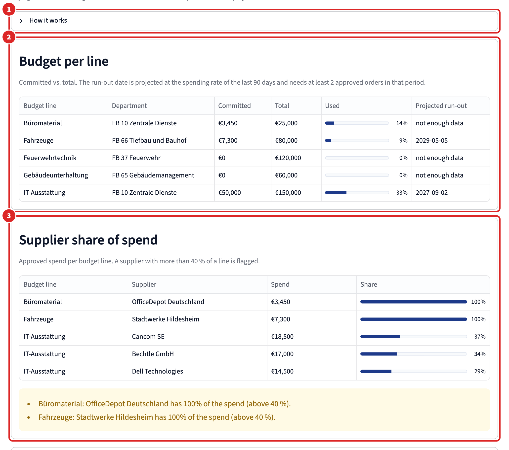

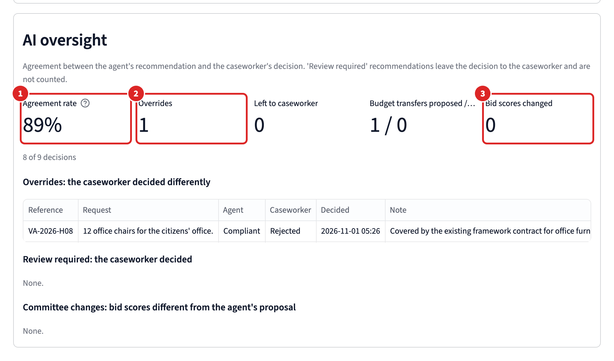

- **How it works** (1) shows the flow diagram from page 2.
- **Budget per line** (2): committed funds against the total. The run-out date is projected from the spending rate of the last 90 days (this needs at least 2 approved orders).
- **Supplier share** (3): a supplier with more than 40 % of a line's spend is flagged.

**AI oversight** shows:
- the **agreement rate** (1) between recommendation and decision (only "Approve" and "Reject" recommendations count)
- the **overrides** (2), with their notes
- the cases left to the caseworker
- budget transfers proposed / accepted
- the **bid scores changed** by the committee (3)

# 9 Sidebar budget meters

For each budget line, a bar shows how much is already committed. On the right is the amount still **available**; below it, "committed of total" and the percentage. The total across all lines is at the top. The figures update immediately after every approval and every budget transfer (sidebar in chapter 2, marker 3).

# 10 Where the human decides

{.small}

| Step | Agent (AI) | Human | Where |
|---|---|---|---|
| Approve / reject a request | checks and recommends | caseworker decides | Request Verification |
| Override the recommendation | shows the notice | justification in the note (at least 15 characters) | Request Verification |
| Budget transfer | suggests a budget line, pre-fills the Deckungsantrag | signs, ticks, approves | Request Verification |
| Bid scores | proposes scores with the rubric | committee reviews, edits, confirms | Bid Evaluation |
| Award | recommends the supplier, writes the letters | approval by an authorised person | Letters / History |
| Sending emails | fills in recipient, subject and text | sends them, marks them as sent | Letters / History |

# 11 FAQ and troubleshooting

**Why is a button disabled?**

- *Approve or Reject:* you are deciding against the recommendation and the note has fewer than 15 characters.
- *Run Evaluation:* the committee confirmation is missing, a cell shows "required", or the weights do not total 100 %. The yellow box gives the reason.
- *✉ Email:* the award has not been approved yet (there's a hint under the checkbox), or the email address is missing.

**An email address is missing.** The address is read from the bid PDF, otherwise from the supplier table. If neither has one, "Email address missing" and an input field appear in the bidder's row.

**A PDF was not read correctly.** Scanned PDFs without text cannot be read. Check the source text under "Agent scoring breakdown" and correct the bidder or price directly in the table. If the bidder name was taken from the file name, a notice appears.

**The evaluation is blocked.** The yellow box lists what is missing per bidder, for example "References / Service – no track record and none named in bid". Enter only those values.

**No request in the Bid Evaluation list.** Only approved requests without an evaluation are offered. Approve a request first, or choose "Other tender (no request)".

**Submitting a request shows an error.** To read new requests the app needs a valid `GEMINI_API_KEY` in the `.env` file.

# 12 Glossary

| German | English | Meaning |
|---|---|---|
| Vergabe | Procurement / award procedure | The procedure for awarding a public contract |
| Vergabestelle | Procurement office | The office that runs procurement procedures |
| Zuschlag | Award (of contract) | Acceptance of an offer; this concludes the contract |
| Absageschreiben | Rejection letter | Notice to unsuccessful bidders (§ 46 UVgO) |
| UVgO | Sub-threshold procurement regulation | Unterschwellenvergabeordnung: rules for procurement below the EU thresholds |
| Anmeldebogen | Registration form | Form for a new award (LuD) or a contract extension |
| Deckungsantrag | Budget cover application | Application to use funds from another budget line |
| Haushaltsposition | Budget line | Part of the budget with its own account |
| Wertungskriterien | Evaluation criteria | Weighted criteria used to score the bids |
| Referenzen / Service | References / Service | Reliability in delivery and support |
| Konzept / Qualität | Concept / Quality | How well the offer fits the request |
| Wertungskommission | Evaluation committee | The panel that reviews and confirms the scores |
| Empfohlener Bieter | Recommended supplier | The bidder with the most points |
| Abweichung | Override | A decision against the agent's recommendation |
| Bindefrist | Offer validity | The period for which a bidder is bound by its offer |
